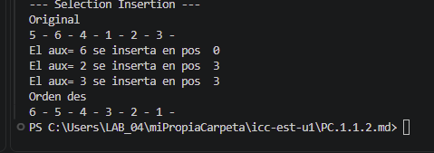
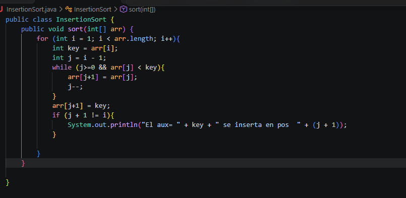

#PC 1.1.2
Metodo de Insercion

Codigo

#Explicacion
Se logro hacer el codigo mediante el metodo d insercion que va cambiando la posicion de los numeros mediante comparaciones de que si es mayor el numero i al q se esta comparando j y ese numero se cambia y la j se guarda en key y se mantiene ahi hasta q alcance el limeite maximo osea al final de la comparacion y con el if se ve q no sea igual a la i para q no haya error yu en la app se imprime llamando al metodo e imprimiendo el arreglo original con una copia osea la d.